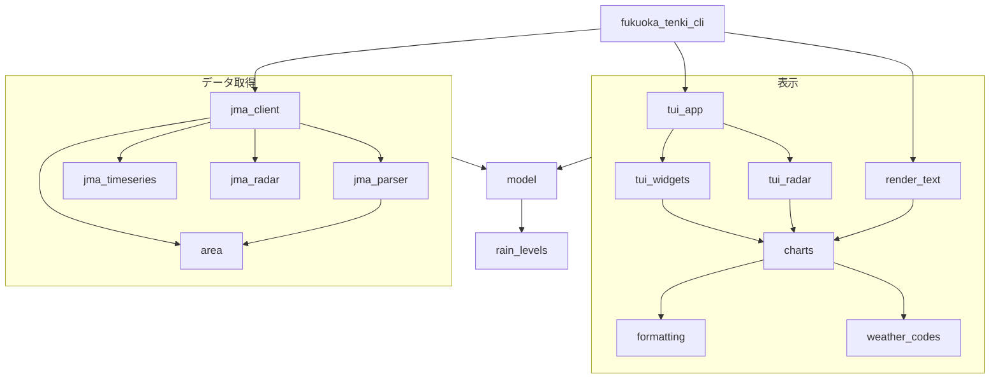

# 福岡市の天気予報アプリ 設計

気象庁のサイト（bosai）のデータだけを使って、福岡市の天気予報・7日間の予報・雨雲レーダーを
ターミナルに表示するアプリケーションの設計。
端末では Textual の TUI で、パイプやリダイレクトの先にはプレーンテキストで表示する。

## 1. 目的・スコープ

- 表示するもの
  - **今日〜明後日の詳細予報** と **3時間ごとの予報**（気温・天気・風）
  - **7日間の予報**。気温は「予想の幅」と平年値つきの棒グラフで見せる
  - **雨雲レーダー**: 地図の上に雨の強さを重ねる。ナウキャスト（1時間前〜1時間先、5分ごと）と
    降水短時間予報（15時間先まで）。福岡市の地点の雨の強さも時系列で出す
- データはすべて気象庁（`www.jma.go.jp`）から取る。ほかの気象サービスや地図サービスは使わない
- 表示は 2 通り。どちらも同じデータを描くだけで、取得とパースは共通
  - **TUI**: 端末で起動したとき。タブ 3 枚（今日・明日 / 7日間 / 雨雲レーダー）
  - **プレーンテキスト**: 標準出力が端末でないとき（パイプ・リダイレクト）と、`--plain` を付けたとき
- 取得に失敗しても落ちない。失敗したものだけがエラーを出し、ほかはそのまま表示する
- 対象外: 他地域への切り替え（CLI からの指定）、ディスクへのキャッシュ、自動更新、通知

## 2. アーキテクチャ

### 2.1 レイヤ

| 層 | モジュール | 知っていること | 知らないこと |
| --- | --- | --- | --- |
| エントリポイント | `fukuoka_tenki_cli` | すべて（部品を組み立てる） | — |
| 表示 | `tui_app`, `tui_widgets`, `tui_radar`, `render_text`, `charts`, `formatting`, `weather_codes` | データの見せ方 | JMA の URL・JSON・タイル、HTTP |
| データ取得 | `jma_client`, `jma_parser`, `jma_timeseries`, `jma_radar`, `area` | JMA の URL・JSON の構造・タイル・地域コード | 表示 |
| ドメイン | `model`, `rain_levels` | 予報のデータ型、雨の強さの凡例 | ほかのすべて |



### 2.2 設計の決まりごと

1. **依存は下向きだけ。** 表示とデータ取得は互いを import しない。両方を知っているのはエントリポイントだけ
2. **表示には `WeatherSource` を渡す。** 表示が必要とするものを並べたプロトコル（`model.py`）で、
   実装は JMA から取る `jma_client.JmaSource`。テストでは偽物（`fixtures.FakeSource`）を渡すので、
   通信もパッチも要らない

   ```python
   class WeatherSource(Protocol):
       def forecast(self) -> Forecast: ...
       def hourly(self) -> tuple[Hourly, ...]: ...
       def radar_frames(self, product: RadarProduct) -> tuple[RadarFrame, ...]: ...
       def radar_map(self, frame, zoom, width, height) -> RadarMap: ...
       def rain_at_city(self, frames) -> tuple[RainPoint, ...]: ...
   ```

3. **I/O は `jma_client` だけ。** パース・地図の合成・グラフの描画は純粋関数なので、保存した JSON や
   テスト中に作った画像だけでテストできる
4. **モデルに JSON やタイルの形を持ち込まない。** 値は文字列でなく `int`、空欄は `None`、データクラスは
   `frozen`。地図も PNG ではなく画素のバイト列（`RadarMap`）で渡すので、表示は Pillow を知らない。
   `12-18時` や `今日` のような文言はモデルに入れず、表示層の `formatting` で作る
5. **失敗は層の境界で `ForecastError` に変換する。** メッセージは利用者にそのまま見せる日本語。
   表示層が捕まえるのは `ForecastError` だけ
6. **グラフは文字で描く。** `charts.py` は Rich の `Text` を返すだけで、TUI とテキスト表示の両方が
   使う。色は補助で、色なし（テキスト表示）でも棒の形で読める
7. **スタイルは各ウィジェットが持つ。** 見た目は各ウィジェットの `DEFAULT_CSS` に書き、
   `TenkiApp.CSS` にはページのレイアウトだけを書く

### 2.3 モジュール一覧

| ファイル | 責務 | 主な公開 API |
| --- | --- | --- |
| `model.py` | データ型、エラー型、`WeatherSource` | `Forecast`, `WeeklyDay`, `Hourly`, `RadarFrame`, `RadarMap`, `RainPoint`, `WeatherSource`, `ForecastError` |
| `rain_levels.py` | 気象庁の降水強度の凡例（8 段階の色と mm/h） | `RAIN_LEVELS`, `rain_level` |
| `area.py` | 対象地域を表す JMA コードと観測所の位置 | `Area`, `FUKUOKA` |
| `jma_parser.py` | 予報 JSON → `Forecast`（純粋関数） | `parse_forecast` |
| `jma_timeseries.py` | 3時間ごとの予報 JSON → `Hourly`（純粋関数） | `parse_hourly` |
| `jma_radar.py` | 雨雲の時刻一覧の読み取り、タイルの位置計算、地図の合成（純粋関数） | `parse_nowcast_frames`, `parse_short_range_frames`, `compose`, `rain_at` |
| `jma_client.py` | HTTP での取得（唯一の I/O）、タイルのキャッシュ | `JmaSource`, `load_forecast` |
| `weather_codes.py` | 天気コード・天気の語 → 文言・代表天気・絵文字 | `weather_label`, `word_kanji` |
| `formatting.py` | 両方の表示で使う文言と桁合わせ | `APP_TITLE`, `day_title`, `frame_label`, `rain_summary`, `pad` |
| `charts.py` | 文字で描くグラフ（純粋関数） | `temp_bar`, `hourly_chart`, `rain_strip` |
| `render_text.py` | プレーンテキストの描画（純粋関数） | `render_text`, `render_hourly_text`, `render_rain_text` |
| `tui_widgets.py` | TUI の部品 | `DayCard`, `HourlyStrip`, `WeeklyTable`, `WeeklyKey`, `ErrorBanner` |
| `tui_radar.py` | 雨雲レーダーのタブ | `RadarPanel`, `RadarImage` |
| `tui_app.py` | 画面構成、タブ、キー操作、バックグラウンドでの読み込み | `TenkiApp` |
| `fukuoka_tenki_cli.py` | 引数の解析、表示の選択、部品の組み立て | `build_parser`, `run_cli`, `main` |

### 2.4 処理の流れ

```text
fukuoka_tenki_cli.main(args)
 ├─ source = JmaSource(FUKUOKA)
 ├─ 端末で --plain なし → TenkiApp(source).run()
 │    ├─ 起動時と r: forecast() と hourly() をそれぞれワーカースレッドで
 │    │    ├─ forecast → タブ 1 のカード、タブ 2 の表（失敗は ErrorBanner）
 │    │    └─ hourly   → タブ 1 の 3時間ごとの予報（失敗はその枠の中だけ）
 │    └─ タブ 3 を初めて開いたとき: radar_frames() → radar_map() と rain_at_city()
 └─ それ以外 → print_forecast(source)
      ├─ forecast()。失敗なら stderr にメッセージを出して終了コード 1
      ├─ hourly()、ナウキャストと降水短時間予報の rain_at_city()。失敗はその節に書いて続ける
      └─ 全部の節をつなげて print

JmaSource.radar_map(frame, zoom, width, height)
 ├─ window_around(観測所, zoom, width, height) → 必要なタイル（1〜4 枚）
 ├─ 地図タイルと雨雲タイルを 4 並列で取得（取得済みはメモリから）
 └─ jma_radar.compose() → RadarMap（線の濃さ + 雨の RGBA）
```

## 3. ドメインモデル（`model.py`）

```python
@dataclass(frozen=True)
class WeeklyDay:
    date: datetime.date
    weather_code: str
    pop: int | None
    temp_min: int | None              # 初日は詳細予報の値で埋める
    temp_max: int | None
    reliability: str | None           # "A" / "B" / "C"
    temp_min_range: TempRange | None = None   # 予想の幅（下限・上限）
    temp_max_range: TempRange | None = None

@dataclass(frozen=True)
class Forecast:
    office: str                       # 発表官署
    reported: datetime.datetime       # 発表時刻（+09:00）
    days: tuple[DayForecast, ...]     # 今日〜明後日
    weekly: tuple[WeeklyDay, ...]     # 明日から 7 日分
    normals: Normals | None = None    # 平年値: 最低・最高気温、7日間の降水量の平年並の範囲

@dataclass(frozen=True)
class Hourly:                         # 3時間ごと
    at: datetime.datetime
    temp: int | None                  # 観測所の気温
    weather: str | None               # 地域の天気の語（"くもり" など）
    wind_direction: str | None
    wind_speed: tuple[int, int] | None    # m/s の範囲

@dataclass(frozen=True)
class RadarFrame:                     # 雨雲の 1 コマ
    product: RadarProduct             # NOWCAST / SHORT_RANGE
    basetime: str                     # タイルの URL に入る値（UTC）
    validtime: str
    member: str                       # "none"、速報版は "immed"
    at: datetime.datetime             # validtime（JST）
    observed: bool                    # 実況・解析なら True、予測なら False

@dataclass(frozen=True)
class RadarMap:                       # 観測所を中心にした 1 コマの地図
    frame: RadarFrame
    zoom: int
    width: int
    height: int
    km_per_pixel: float
    outline: bytes                    # 1 画素 1 バイト: 海岸線・境界線の濃さ
    rain: bytes                       # 1 画素 4 バイト（RGBA）: 凡例の色、雨がなければ透明
    city: tuple[int, int]             # 観測所の画素
    complete: bool                    # 未公開のタイルがあれば False

@dataclass(frozen=True)
class RainPoint:                      # 観測所の地点の雨の強さ
    at: datetime.datetime
    observed: bool
    level: RainLevel | None           # 降っていなければ None
    known: bool = True                # タイルが未公開なら False
```

`DayForecast`・`PopSlot`・`TempRange`・`Normals` は同じ形の小さなデータクラス。

## 4. データ取得

使うのは気象庁のサイトのデータだけ。認証は不要。`User-Agent: fukuoka-tenki/1.0` を付け、
タイムアウトは 10 秒。途中で切れた応答（`IncompleteRead`・接続リセット）は 1 回だけ取り直す。

| データ | URL（`https://www.jma.go.jp/` 以下） | 使うところ |
| --- | --- | --- |
| 府県天気予報・週間天気予報 | `bosai/forecast/data/forecast/{office}.json` | 今日・明日、7日間 |
| 地域時系列予報（3時間ごと） | `bosai/jmatile/data/wdist/VPFD/{region}.json` | 3時間ごとの予報 |
| ナウキャストの時刻一覧 | `bosai/jmatile/data/nowc/targetTimes_N1.json`（実況）、`targetTimes_N2.json`（予測） | 雨雲レーダー |
| 降水短時間予報の時刻一覧 | `bosai/jmatile/data/rasrf/targetTimes.json` | 雨雲レーダー（15時間） |
| 雨雲のタイル | `bosai/jmatile/data/{nowc,rasrf}/{basetime}/{member}/{validtime}/surf/{hrpns,rasrf}/{z}/{x}/{y}.png` | 雨雲の地図、地点の雨 |
| 地図のタイル | `tile/jma/base/{z}/{x}/{y}.png` | 雨雲の下の地図 |

- 同じホストの `tile/gsi/` 以下にも背景地図があるが、国土地理院の地図なので使わない
- どの JSON のどの区域を使うかは `Area` にまとめてある。福岡市は `FUKUOKA`

  | `Area` のフィールド | 用途 | 福岡市 |
  | --- | --- | --- |
  | `office` | 予報 JSON（府県予報区） | `400000` 福岡県（発表: 福岡管区気象台） |
  | `region` | 詳細予報の天気・風・波・降水確率、3時間ごとの予報（一次細分区域） | `400010` 福岡地方 |
  | `weekly_region` | 週間予報の天気・降水確率 | `400000` 福岡県 |
  | `station` | 気温（詳細・週間とも） | `82182` 福岡 |
  | `lat`, `lon` | 雨雲の地図の中心、地点の雨を読む位置 | 33°34.9′N 130°22.5′E（`amedastable.json` の福岡） |

### 4.1 予報 JSON（`jma_parser.py`）

トップレベルは 2 要素の配列。`[0]` が詳細予報（3 日分）、`[1]` が週間予報（7 日分）。

| パス | 対象 `area.code` | 内容 | 使うキー |
| --- | --- | --- | --- |
| `[0].publishingOffice` | — | 発表官署 | — |
| `[0].reportDatetime` | — | 発表時刻 | — |
| `[0].timeSeries[0]` | `region` | 日別の天気・風・波（3 日分） | `weatherCodes`, `weathers`, `winds`, `waves` |
| `[0].timeSeries[1]` | `region` | 6 時間ごとの降水確率 | `pops` |
| `[0].timeSeries[2]` | `station` | 気温（`T00:00` = 最低、`T09:00` = 最高） | `temps` |
| `[1].timeSeries[0]` | `weekly_region` | 週間の天気コード・降水確率・信頼度 | `weatherCodes`, `pops`, `reliabilities` |
| `[1].timeSeries[1]` | `station` | 週間の最低/最高気温と予想の幅 | `tempsMin`, `tempsMax`, `tempsMin{Lower,Upper}`, `tempsMax{Lower,Upper}` |
| `[1].tempAverage` | `station` | 平年の最低/最高気温 | `min`, `max` |
| `[1].precipAverage` | `station` | 7日間の降水量の合計の平年並の範囲（mm） | `min`, `max` |

各 `timeSeries` は `timeDefines`（ISO 8601、`+09:00`）と `areas` を持ち、`areas[i]` の各配列は
`timeDefines` と同じ長さで対応する。

注意点:

- **地域は `area.code` で引く**（`find_area`）。`areas` の並び順には依存しない
- **空文字 `""` の枠がある**（週間予報の初日の `pops` / `tempsMin` / `tempsMax` /
  `reliabilities` など）。モデルでは `None` にし、表示では `-` にする
- **週間予報の初日（明日）の気温は空。** 詳細予報が同じ日を受け持つため。7日間の表とグラフが初日だけ
  欠けないよう、詳細予報の明日の最低・最高で埋める（降水確率・信頼度・予想の幅は空のまま）
- **気温と降水確率は文字列で来る。** パースの時点で `int` にするので、数値でなければその場で形式エラーになる
- **`weathers` / `winds` は全角スペース区切り**（例: `くもり　時々　雨`）、`waves` は全角数字
  （例: `１．５メートル`）。どちらも `unicodedata.normalize("NFKC", ...)` で半角にそろえる
- **`temps` はインデックスではなく時刻で解釈する。** `timeDefines` の並びは発表時刻によって
  `09:00, 00:00, ...` のように前後するため、日付ごとに `00:00` → 最低、`09:00` → 最高 と対応付ける
- **当日は最高気温だけを表示する。** 当日の最低気温（朝）は発表時点で過ぎていることが多く、
  値が最高気温の複製になっている場合がある。17 時発表では当日の気温がそもそも含まれない
- **6 時間降水確率は発表時刻より後の枠だけ**が入る（11 時発表なら当日は 12-18 時と 18-24 時の 2 枠、
  17 時発表なら 18-24 時の 1 枠）
- `tempAverage` / `precipAverage` がなければ平年値は `None`（表示しない）

### 4.2 3時間ごとの予報（`jma_timeseries.py`）

- `areaTimeSeries`: 地域の 3 時間ごとの天気（`晴れ` / `くもり` / `雨` / `雨または雪` / `雪`）と風
  （`{"direction": "南東", "range": "3 5"}` → 南東 3〜5m/s）。約 30 時間分
- `pointTimeSeries`: 観測所の気温。地域より 1 つ多く、最後の時刻には天気と風がない
- 時刻で突き合わせて `Hourly` にする

### 4.3 雨雲レーダー（`jma_radar.py`）

**時刻一覧（フレーム）**

- ナウキャスト: `N1` の実況から直近 1 時間（13 コマ）、続けて `N2` の予測 12 コマ（5 分ごと、1 時間先まで）。
  要素 `hrpns`（高解像度降水ナウキャスト）を使う
- 降水短時間予報: 一覧は他の要素（`sjfcstmap`・`slmcs` など）と共用なので、要素 `rasrf` の行だけを見る。
  - 最新の解析（`validtime == basetime`）を「いま」とする
  - それより後の各 `validtime` は、一覧に載っている発表のものを使う。6 時間先までは 10 分ごとの速報版、
    その先は毎正時の発表
  - **速報版は `member` が `"immed"`。** タイルの URL にもこの値が入る。`none` で取ると 404 になる
- 時刻は UTC の `20260912083000` 形式。JST に直して `RadarFrame.at` にする

**タイルと地図の合成**

- タイルは Web Mercator、256 × 256 画素。雨雲は偶数のズーム（4〜10）にだけあり、奇数は空のタイルが返る。
  TUI は 4（九州、約 8km/画素）・6（北部九州、約 2km/画素）・8（福岡市周辺、約 0.5km/画素）を使う
- 観測所が中心に来る窓（`window_around`）を計算し、重なるタイル（1〜4 枚）を貼り合わせる
- 地図タイル（`tile/jma/base`）は黒い線に白いふちが付いた透過 PNG。「暗さ × 不透明度」を線の濃さとして
  取り出すので、白いふちは消える
- 雨雲タイルはパレット PNG で、色がそのまま凡例（`rain_levels.RAIN_LEVELS`）の色

  | mm/h | 0〜1 | 1〜5 | 5〜10 | 10〜20 | 20〜30 | 30〜50 | 50〜80 | 80〜 |
  | --- | --- | --- | --- | --- | --- | --- | --- | --- |
  | 色 | `#f2f2ff` | `#a0d2ff` | `#218cff` | `#0041ff` | `#faf500` | `#ff9900` | `#ff2800` | `#b40068` |
  | 語 | 弱い雨 | 雨 | 雨 | やや強い雨 | 強い雨 | 激しい雨 | 非常に激しい雨 | 猛烈な雨 |

  10mm/h 以上の語は気象庁の予報用語（雨の強さと降り方）

- **地点の雨**（`rain_at`）は、ズーム 8 のタイルの観測所の画素の色を凡例と照らし合わせて読む
- 未公開のタイル（404）は透明として扱い、`RadarMap.complete` / `RainPoint.known` を False にする。
  「雨なし」とは区別する

### 4.4 エラー

| 状況 | 変換する場所 | `ForecastError` のメッセージ |
| --- | --- | --- |
| 通信失敗・タイムアウト・HTTP エラー・読み込み中の切断（`OSError`, `http.client.HTTPException`） | `fetch_json`, `fetch_tile` | 〜を取得できませんでした: … |
| 本文が JSON として読めない（`ValueError`） | `fetch_json` | 〜の JSON を読めませんでした: … |
| キーや地域コードが見つからない、型が違う、数値でない | `parse_forecast`, `parse_hourly`, `parse_*_frames` | 〜の形式が想定と違います: …（API の仕様変更の検知） |
| タイルが画像として読めない | `compose`, `rain_at` | 雨雲の画像を読めませんでした: … |
| タイルが 404 | —（エラーにしない） | 地図に「まだ一部しか公開されていません」と出す |

「〜」には天気予報・3時間ごとの予報・雨雲レーダー・降水短時間予報・地図が入る。

## 5. 天気コード（`weather_codes.py`）

- 詳細予報は `weathers` の文言をそのまま使い、先頭に絵文字を付ける
- 週間予報はコードしかないので、主要コードの辞書 `TELOPS` を持つ。文言と「代表天気」は気象庁サイトの定義
  `https://www.jma.go.jp/bosai/forecast/js/forecast_const.js` の `TELOPS`
  （`コード: [昼アイコン, 夜アイコン, 代表天気, 日本語, 英語]`）に合わせる

  | コード | 表示 | 代表天気 |
  | --- | --- | --- |
  | 100 | 晴 | 100 |
  | 101 | 晴時々曇 | 100 |
  | 102 | 晴一時雨 | 300 |
  | 110 | 晴後時々曇 | 100 |
  | 111 | 晴後曇 | 100 |
  | 200 | 曇 | 200 |
  | 201 | 曇時々晴 | 200 |
  | 202 | 曇一時雨 | 300 |
  | 203 | 曇時々雨 | 300 |
  | 210 | 曇後時々晴 | 200 |
  | 211 | 曇後晴 | 200 |
  | 212 | 曇後一時雨 | 300 |
  | 213 | 曇後時々雨 | 300 |
  | 214 | 曇後雨 | 300 |
  | 300 | 雨 | 300 |
  | 301 | 雨時々晴 | 300 |
  | 302 | 雨時々止む | 300 |
  | 311 | 雨後晴 | 300 |
  | 313 | 雨後曇 | 300 |
  | 400 | 雪 | 400 |

- 絵文字は **代表天気** で決める（先頭の桁ではない。例: 102 晴一時雨 は雨扱い）。TUI のカードの枠の色も
  代表天気で決める

  | 代表天気 | 絵文字 | カードの枠 | 3時間ごとの予報 |
  | --- | --- | --- | --- |
  | 100 | ☀️ | orange | 晴 |
  | 200 | ☁️ | gray | 曇 |
  | 300 | ☔ | dodgerblue | 雨 |
  | 400 | ⛄ | white | 雪（雨または雪は「雨雪」） |

- 辞書にないコードは、文言をコードそのまま（`天気コード xxx`）にし、代表天気は先頭の桁 × 100 で代用する。
  それでも表にない代表天気は絵文字 `❓`、枠は既定の色
- 3時間ごとの予報は列をそろえるため、幅が端末ごとに違う絵文字を使わず、漢字 1〜2 字（`word_kanji`）で出す

## 6. 表示

### 6.1 グラフ（`charts.py`）

| 関数 | 描くもの |
| --- | --- |
| `temp_bar` | 1 日分の気温の棒。`█` 予想の最低〜最高（色は気温: 寒い青 → 暑い赤）、`░` 予想の幅、`┊` 平年値。7 日で同じ目盛り（`week_scale`） |
| `hourly_chart` | 3時間ごとの列: 時刻（0 時は日付）、天気、気温、気温の棒（1/8 字刻み）、風向、風速 |
| `rain_strip` | 地点の雨を 1 コマ 1 列で。高さと色が凡例の段階（`▁` 1mm/h 未満 … `█` 80mm/h 以上）、`·` 雨なし、空白は未取得。予測のコマは地の色を暗くする。下に時刻の目盛り |

### 6.2 文言（`formatting.py`）

| 関数・定数 | 例 |
| --- | --- |
| `APP_TITLE` | `福岡市の天気予報` |
| `day_title` | `9/12(土) 今日`（今日・明日・明後日を付ける） |
| `format_report` | `福岡管区気象台 2026-09-12 11:00 発表` |
| `normals_text` | `平年値: 最低 21.6℃ / 最高 28.6℃、7日間の降水量 平年並 9.6〜40.1mm` |
| `frame_label` | `17:30 実況`、`18:15 予測（+45分）`、`13日 8:00 予測（+14時間）`、`18:00 解析` |
| `rain_summary` | `いまは降っていません。18:20ごろから降り出す見込み。最も強いときで雨（1〜5mm/h）` |
| `pad` / `center` | 全角文字を 2 桁と数えて桁をそろえる |

### 6.3 プレーンテキスト（`render_text.py`）

2026-09-12 17:00 発表のデータより（抜粋）:

```text
■ 7日間の予報（█ 最低〜最高  ░ 予想の幅  ┊ 平年値）
  9/13(日) ☔ 曇後雨        24℃    ┊   ██████████        30℃   降水  -%  信頼度 -
  9/14(月) ☔ 曇時々雨      25℃    ┊   ░████████░░░░░    29℃   降水 70%  信頼度 -
  9/15(火) ☔ 曇時々雨      24℃    ┊ ░░███████░░         28℃   降水 80%  信頼度 A
  9/16(水) ☁️ 曇            24℃    ░░░░███████░░░        28℃   降水 40%  信頼度 C
  ...
  平年値: 最低 21.6℃ / 最高 28.6℃、7日間の降水量 平年並 9.6〜40.1mm

■ 3時間ごとの予報
   18時  21時  9/13  3時   6時   9時   12時  15時  18時  21時  9/14
    曇    曇    曇    曇    曇    曇    雨    雨    雨    曇
   27℃   27℃   26℃   25℃   24℃   28℃   29℃   28℃   27℃   27℃   26℃
                                 ▃▃▃▃  ████  ▃▃▃▃
   ▇▇▇▇  ▇▇▇▇  ▂▂▂▂              ████  ████  ████  ▇▇▇▇  ▇▇▇▇  ▂▂▂▂
   ████  ████  ████  ▆▆▆▆  ▁▁▁▁  ████  ████  ████  ████  ████  ████
   南東   南    南    南   南東   北    北    北    北    南
   3-5m  3-5m  3-5m  3-5m  3-5m  3-5m  6-9m  3-5m  6-9m  3-5m

■ 福岡市の雨（ナウキャスト（1時間先まで））
  いまは降っていません。19:25まで雨の予想はありません
  · · · · · · · · · · · · ·
    18:30       19:00
```

- 詳細予報（今日〜明後日）は前と同じ形で、その後に上の節が続く
- 明後日の気温・降水確率は詳細予報に含まれないので、行ごと省略する
- 空欄は `-` にする。`0`（0% や 0℃）は値なのでそのまま出す
- 3時間ごとの予報と雨の節は、取得に失敗するとその節に理由を書き、残りはそのまま出す

### 6.4 TUI（`tui_app.py`, `tui_widgets.py`, `tui_radar.py`）

```text
Header       福岡市の天気予報 — 福岡管区気象台 2026-09-12 17:00 発表
ErrorBanner  （予報の取得に失敗したときだけ）理由と「r で再読み込みします」
Tabs         1 今日・明日   2 7日間   3 雨雲レーダー
Footer       r 再読み込み  q 終了（雨雲レーダーではその操作も）
```

**タブ 1 今日・明日**

- `DayCard` × 3: 天気（絵文字と文言）、最低・最高気温、6 時間ごとの降水確率バー、風・波。
  枠の色は代表天気。横幅 96 桁以上で横に並べ、未満では縦に積む（`HORIZONTAL_BREAKPOINTS` が
  Screen に `-wide` / `-narrow` を付け、`TenkiApp.CSS` が `#days` の `layout` を切り替える）
- `HourlyStrip`: `hourly_chart`。幅が足りなければ右側を切る（折り返さない）

**タブ 2 7日間**

- `WeeklyTable`: 日付（土 青・日 赤）、天気、最低、気温の棒（`temp_bar`）、最高、降水確率バー、信頼度
- `WeeklyKey`: 棒の凡例と平年値

**タブ 3 雨雲レーダー**（`RadarPanel`）

```text
18:20 実況  ナウキャスト（1時間先まで）  北部九州（東西 約245km）
┌──────────────────────────────────────────┐
│  地図（RadarImage）: 1 字に上下 2 画素    │  海岸線・境界線は暗い灰色、雨は凡例の色、
│              ✚ 福岡市                     │  観測所に赤い十字
└──────────────────────────────────────────┘
                        ▼                        ← いま表示しているコマ
· · · · · · ▁▁▂▂· · · · · · · · · · · · · ·      ← 福岡市の地点の雨（予測は暗い地）
17:30       18:00       18:30       19:00
福岡市: いまは降っていません。18:40ごろから降り出す見込み。…
██0〜1 ██1〜5 ██5〜10 … mm/h  出典: 気象庁
```

- 地図は半角ブロック `▀` で描く。1 字の前景色が上の画素、背景色が下の画素なので、1 字に正方形に近い
  画素が 2 つ入る。地図の大きさは `RadarImage` の大きさ（幅 × 高さの 2 倍）に合わせて取り直す
- キー（パネルにフォーカスがあるとき）

  | キー | 動作 |
  | --- | --- |
  | ← / → | 前 / 次のコマ（端で止まる） |
  | space | 再生 / 停止（0.6 秒ごと、最後まで行くと最初に戻る） |
  | + / − | 拡大 / 縮小（九州 ↔ 北部九州 ↔ 福岡市周辺） |
  | m | ナウキャスト ↔ 降水短時間予報 |

- タブを初めて開いたときに読み込み、それまでは雨雲のデータを一切取らない。`r` は開いたことがあれば
  雨雲も読み直す
- 取るのは表示するコマの地図だけ。タイルは `JmaSource` がメモリに持つ（最大 512 枚）ので、
  戻ったり繰り返し再生したりしても取り直さない。再生中は前の地図が届くまで次へ進まない
- 読み込みは `@work(thread=True, exclusive=True)` のワーカースレッド。取り消されたワーカー
  （`get_current_worker().is_cancelled`）の結果は捨てるので、古い結果が新しい表示を上書きしない
- 読み込み中の表示は情報行の「読み込み中…」だけ。`RadarImage.loading` は使わない。Textual は
  `loading` のウィジェットを 0×0 の大きさとして扱うので、地図を取るための大きさが分からなくなる
- 色は 24 ビットカラー前提。対応していない端末では Textual が近い色に置き換える

## 7. エントリポイント（`fukuoka_tenki_cli.py`）

| 条件 | 表示 |
| --- | --- |
| 標準出力が端末で、`--plain` なし | TUI |
| `--plain` あり、または標準出力が端末でない（パイプ・リダイレクト） | プレーンテキスト |

- 引数まわりはリポジトリのほかのツールと同じ形にしてある: `build_parser()` / `run_cli(namespace)` /
  `main(args: Args)`（`Args` は pydantic）。そのまま `packages/cli.py` のサブコマンドとして載せられる
- 終了コード: 成功なら 0。テキスト表示で予報の取得に失敗したら 1（`SystemExit("エラー: …")` で
  メッセージを stderr に出す）。3時間ごとの予報や雨の失敗では終了しない。TUI は失敗しても終了しない

## 8. テスト

`unittest` で、モジュールごとに 1 ファイル。どれも通信しない。

| ファイル | 確かめること |
| --- | --- |
| `test_jma_parser.py` | 地域をコードで引く、正規化、気温を時刻で対応付ける、当日の最低気温を出さない、空欄 → `None`、週間の初日を詳細予報で埋める、予想の幅、平年値、形式エラー |
| `test_jma_timeseries.py` | 3 時間ごとの突き合わせ、最後の気温に天気がないこと、形式エラー |
| `test_jma_radar.py` | 観測所のタイル、窓とタイル、地図の合成（線・白いふち・雨・未公開タイル）、地点の雨、ナウキャストと降水短時間予報のコマの選び方（速報版の `immed` を含む） |
| `test_jma_client.py` | URL と `User-Agent`、通信失敗・切断・JSON でない本文、途中で切れた応答の取り直し、404、タイルのキャッシュ（未公開は覚えない） |
| `test_rain_levels.py`, `test_model.py` | 凡例のラベルと色、「いま」のコマ |
| `test_charts.py` | 気温の色、目盛り、気温の棒、3時間ごとの列、地点の雨の列 |
| `test_formatting.py` | 時刻、コマの見出し、風、平年値、雨の見通しの文 |
| `test_render_text.py` | テキストの見た目（7日間の棒・平年値・0 の扱い・各節） |
| `test_weather_codes.py`, `test_tui_widgets.py` | 天気コード、降水確率バー、週間の行、凡例 |
| `test_tui_app.py` | `App.run_test()` で起動し、各タブの内容、雨雲はタブを開くまで取らないこと、エラーと再読み込み、横並び/縦積み |
| `test_tui_radar.py` | 画素の色の重ね方、半角ブロックの上下、パネルの操作（コマ送り・拡大縮小・切り替え・再生・エラー） |
| `test_fukuoka_tenki_cli.py` | 表示の選び分け、失敗時の終了メッセージ、失敗した節があっても残りを出すこと |

フィクスチャ（`testdata/`、読み込みは `fixtures.py`）はどれも 2026-09-12 の実レスポンス:

- `forecast_400000.json`: 11:00 発表。パーサが読む部分だけに削り、週間は 3 日分。北九州地方の区域を
  1 つ残して「地域をコードで引く」ことを、週間予報の最後の天気コードを実在しない `999` に変えて
  未知のコードの扱いを確かめる
- `forecast_400000_1700.json`: 17:00 発表。福岡地方以外の区域を削っただけで、7 日分・予想の幅・
  平年値がそろい、当日の気温がない
- `vpfd_400010.json`: 17:00 発表の 3時間ごとの予報
- `nowc_targetTimes_N1.json`, `nowc_targetTimes_N2.json`, `rasrf_targetTimes.json`:
  雨雲の時刻一覧を新しい方から削ったもの。速報版（`immed`）の行を含む

タイルは画像ファイルを置かず、テストの中で Pillow で作る（`radar_tile`, `base_tile`）。
TUI とエントリポイントのテストは `FakeSource` を渡す。

## 9. ビルド・実行

| ターゲット | ルール | 内容 |
| --- | --- | --- |
| `fukuoka_tenki_lib` | `py_library` | アプリ本体（テスト以外の全モジュール）。依存は pillow・pydantic・rich・textual |
| `fukuoka_tenki` | `py_binary` | 実行ファイル（`fukuoka_tenki_cli.py`） |
| `fixtures` | `py_library`（`testonly`） | テスト用のフィクスチャと `testdata/*.json` |
| `test_*` | `py_test` | テストファイルごとに 1 つ。`test_all` でまとめて実行できる |
| `*.lint` | `sh_test` | `//rules/python/lint` のマクロが生成する ruff + mypy |

```sh
# Bazel（リポジトリの Python 3.14 を使う）
bazel run  //packages/fukuoka_tenki_forcast:fukuoka_tenki
bazel run  //packages/fukuoka_tenki_forcast:fukuoka_tenki -- --plain
bazel test //packages/fukuoka_tenki_forcast/...   # テスト + ruff/mypy

# Bazel を使わない場合（リポジトリ直下で、uv の仮想環境（.venv）の Python 3.14 を使う）
python -m packages.fukuoka_tenki_forcast.fukuoka_tenki_cli
```

- import はリポジトリの慣習どおり `from packages.… import …` の絶対パスで書く。こうすると `.lint` の
  mypy がモジュールをまたぐ呼び出しまで型検査する（`imports = ["."]` と平置きの import の組み合わせ
  では、mypy からは `Any` に見えて検査されない）

## 10. 制約と注意

- **公開 API ではない。** `bosai` 以下の JSON もタイルも気象庁サイトの内部データで、仕様は公開されて
  いない。予告なく変わりうる（形式エラーとして表に出る）
- **速報版と公開の遅れ。** 降水短時間予報の一覧には、タイルがまだない発表が載ることがある。そのコマは
  「まだ一部しか公開されていません」と表示し、雨なしとは区別する
- **解像度。** 地図は 1 字に 2 画素なので、北部九州で約 2km/画素、福岡市周辺で約 0.5km/画素
- **取得量。** 1 コマあたり地図タイル 1〜4 枚と雨雲タイル 1〜4 枚。地点の雨はコマごとに 1 枚。
  同時に 4 本まで、取得済みはメモリから。気象庁の地図ページよりずっと少ない
- **出典。** 画面とテキストに「出典: 気象庁」を出す

## 11. 拡張するとき

| やりたいこと | 触る場所 |
| --- | --- |
| 地域を増やす | `area.py` に `Area` を足し、エントリポイントで選べるようにする。パーサ・クライアント・地図は `Area` を受け取るので変えなくて済む想定（福岡県以外の JSON では未検証）。見出しの `APP_TITLE`・`CITY_NAME` はいまは固定 |
| 出力形式を増やす（JSON など） | データを受け取る `render_*.py` を足し、エントリポイントで選ぶ |
| 取得方法を変える（ディスクキャッシュ・リトライ） | `jma_client.py` の中だけ。表示は `WeatherSource` しか知らない |
| 雨雲の要素を増やす（雷ナウキャストなど） | `RadarProduct` と `jma_client.ELEMENTS` に足し、`jma_radar` にコマの選び方を足す |
| 天気コードを増やす | `weather_codes.TELOPS` に足す |

## 12. 参考

- 気象庁 天気予報（福岡県）: <https://www.jma.go.jp/bosai/forecast/#area_type=offices&area_code=400000>
- 気象庁 雨雲の動き（ナウキャスト）: <https://www.jma.go.jp/bosai/nowc/>
- 気象庁 今後の雨（降水短時間予報）: <https://www.jma.go.jp/bosai/kaikotan/>
- 地域コード一覧: <https://www.jma.go.jp/bosai/common/const/area.json>
- 観測所の一覧（位置）: <https://www.jma.go.jp/bosai/amedas/const/amedastable.json>
- 天気コード定義（`TELOPS`）: <https://www.jma.go.jp/bosai/forecast/js/forecast_const.js>
- Textual: <https://textual.textualize.io/>
