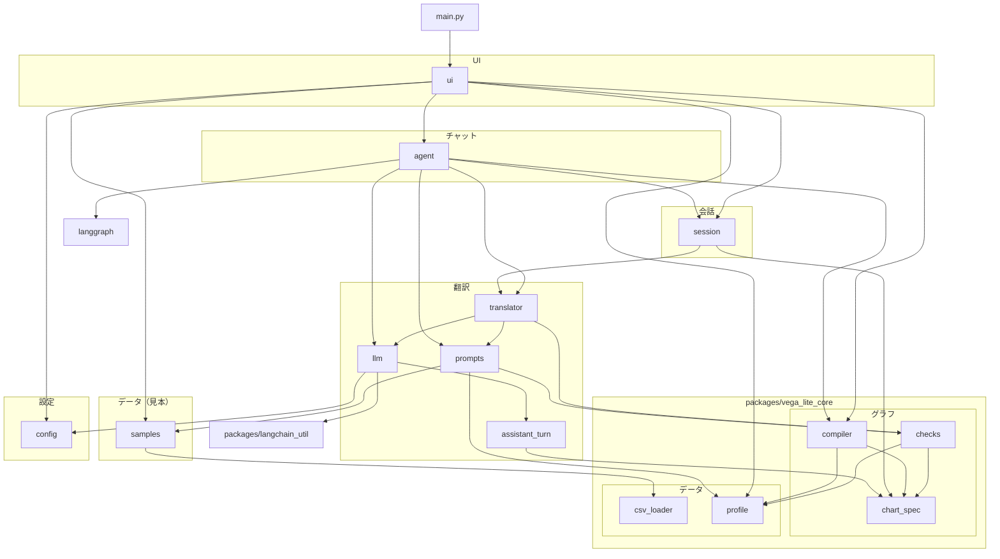
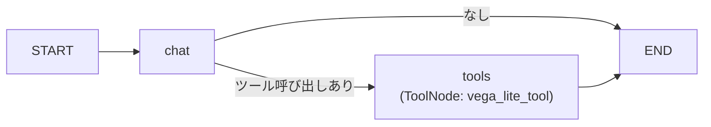

# CSV → Vega-Lite チャットアプリ 設計

CSV をアップロードし、チャットで「月ごとの売上の推移を見せて」のように頼むと、ローカルの LLM（Ollama）が
Vega-Lite のグラフ仕様に翻訳し、Streamlit で描くアプリケーションの設計。
最初のグラフは LLM が選び、そのあとはチャットで今のグラフを直していく。チャットは LangGraph のグラフで動き、
描いてほしいと頼まれたときだけツール `vega_lite_tool` を呼ぶ。それ以外の質問には普通のチャットとして、
返答をストリーミングで返す（8 章）。

## 1. 目的・スコープ

- vibe coding club のデモ。ノート PC 上で 1 人で使い、Ollama は `localhost` で動かす
- 流れ
  - CSV を読み込むと、LLM が最初のグラフを 1 つ選んで描く
  - 以降はチャットで今のグラフを直す（「積み上げにして」「2025年だけ」「地域で色分けして」）
  - 表やグラフについての質問（「どんな列がある？」「今のグラフは何？」）には、文章で答える（ストリーミング）
  - 描くか答えるかはチャットのモデルが決める。描くときだけ `vega_lite_tool` を呼ぶ
  - 頼みがあいまいなとき・描けないときは、LLM が聞き返す
- LLM が見るのはデータの **プロフィール**（列名・型・種類の数・範囲・数行の見本）だけ。データ本体は渡さず、
  描画のときにアプリが付ける
- LLM が書くのは Vega-Lite そのものではなく、その小さな部分集合 `ChartSpec`（pydantic）。
  `ChartSpec` を実際の列と照らして検査し、純粋関数で Vega-Lite に変換する
- 生成したコードは実行しない。集計・絞り込みは Vega-Lite の宣言的な変換だけで行う
- 対象外: `.xlsx`・`.tsv`・`.xls`、UTF-8 以外の CSV、`2025年1月5日` や和暦の日付、1 回の会話で複数の表、
  仕様の手修正、レイヤー（線＋点など）、`calculate`、ホスティング・複数人での利用、会話の保存

## 2. アーキテクチャ

### 2.1 レイヤ

グラフ層と、データ層の `csv_loader.py`・`profile.py` は、`vega_lite_ai` と共有するパッケージ `packages/vega_lite_core` にある
（表と図では `vega_lite_core/` と書く）。このアプリに残るのは、翻訳のモデルの返答の型 `AssistantTurn`（`assistant_turn.py`）と
見本（`samples.py`）。

| 層 | モジュール | 知っていること | 知らないこと |
| --- | --- | --- | --- |
| UI | `main.py`, `ui.py` | Streamlit、画面の構成、部品の組み立て | — |
| チャット | `agent.py` | LangGraph のグラフ、`vega_lite_tool`、履歴の組み立て、描画（翻訳→変換） | Streamlit |
| 会話 | `session.py` | ターンの並び、今のグラフ、直近の依頼 | Streamlit、Ollama |
| 翻訳 | `translator.py`, `prompts.py`, `llm.py`, `assistant_turn.py` | プロンプトの組み立て、修正ループ、LangChain・Ollama | Streamlit、Vega-Lite |
| グラフ | `vega_lite_core/chart_spec.py`, `vega_lite_core/checks.py`, `vega_lite_core/compiler.py` | `ChartSpec` の形と規則、Vega-Lite | LLM、Streamlit |
| データ | `vega_lite_core/csv_loader.py`, `vega_lite_core/profile.py`, `samples.py` | CSV の読み方、pandas、プロフィール | LLM、Vega-Lite、Streamlit |
| 設定 | `config.py` | `config.yaml` の形 | ほかのすべて |



### 2.2 設計の決まりごと

1. **依存は下向きだけ。** グラフ層とデータ層は LLM も Streamlit も知らない。Streamlit を import するのは
   `ui.py` と `main.py` だけ
2. **LLM の出力は 2 段階で検査する。** 形（列挙値・必須項目）は Ollama の制約付き生成と pydantic が、
   中身（列があるか、型と集計が合うか）は `checks.check_chart(spec, profile)` が見る。中身の検査には
   プロフィールが要るので pydantic のバリデータには入れず、純粋関数にする。返すのはエラー文の一覧で、
   そのまま修正の依頼文になる
3. **モデルは外から渡す。** 翻訳には `StructuredModel`、チャットには LangChain の `BaseChatModel` を渡す。
   2 つをまとめた `llm.Models` を、本物は `llm.ollama_models()` が作り、テストでは台本どおりに返す偽物
   （`fake_models.py`）を渡すので、Ollama もパッチも要らない

   ```python
   class StructuredModel(Protocol):
       def __call__(self, messages: Sequence[BaseMessage]) -> RawReply: ...

   @dataclass(frozen=True)
   class RawReply:
       text: str                      # モデルの返答そのまま（修正の依頼と失敗時の表示に使う）
       turn: AssistantTurn | None     # パースできたとき
       parse_error: str | None
   ```

4. **I/O は端に寄せる。** Ollama との通信は `llm.py` だけ。ファイルを読むのは `csv_loader.py` と、
   起動時の `config.py`・`prompts.py` だけ。プロフィール・検査・変換・プロンプトの組み立ては純粋関数
5. **見た目はコンパイラが決める。** ツールチップ・幅・高さ・テーマは LLM に選ばせない
6. **設定は `config.yaml` だけ。** 起動時に pydantic で検査し、知らないキーはエラーにする（`extra="forbid"`）。
   `prompts.yaml` も同じ
7. **失敗は 3 種類に分ける**（7.3）。LLM の間違いは修正ループ、コンパイラのバグは表示してログ、
   Ollama に届かないときは再試行ボタン
8. **言語。** 利用者に見せる文言は日本語。LLM への指示とエラー文は英語。返答は依頼の言語に合わせる

### 2.3 モジュール一覧

`vega_lite_core/` で始まる 5 つは `packages/vega_lite_core` のモジュール（説明は `packages/vega_lite_core/README.md`）。

| ファイル | 責務 | 主な公開 API |
| --- | --- | --- |
| `config.py` | `config.yaml` の読み込みと検査 | `AppConfig`, `load_config` |
| `vega_lite_core/csv_loader.py` | CSV のバイト列 → DataFrame。UTF-8 の判定、日付の変換 | `load_csv`, `InputError` |
| `vega_lite_core/profile.py` | DataFrame → プロフィール、プロンプト用の YAML（純粋関数） | `DataProfile`, `ColumnProfile`, `profile_frame`, `profile_yaml` |
| `samples.py` | 同梱の見本 CSV の一覧 | `Sample`, `SAMPLES` |
| `vega_lite_core/chart_spec.py` | LLM が書くグラフの型（構造だけ） | `ChartSpec`, `Encoding`, `Filter`, `TopN` |
| `assistant_turn.py` | 翻訳のモデルの返答の型（グラフとメッセージ） | `AssistantTurn` |
| `vega_lite_core/checks.py` | `ChartSpec` をプロフィールと照らす（純粋関数） | `check_chart`（`empty_column_errors` は `vega_lite_ai` 用） |
| `vega_lite_core/compiler.py` | `ChartSpec` → Vega-Lite の dict、Vega-Lite のスキーマ検査（純粋関数） | `compile_chart`, `vega_lite_errors`, `with_inline_data` |
| `prompts.py` | `prompts.yaml` の読み込みと検査、メッセージの組み立て | `PromptBook`, `load_prompts`, `build_messages`, `chat_system_prompt`, `repair_message` |
| `llm.py` | Ollama との通信（唯一の外部 I/O）、ウォームアップ | `ollama_models`, `Models`, `ollama_model`, `warm_up`, `reaching_ollama`, `OllamaUnavailable`, `StructuredModel`, `RawReply` |
| `translator.py` | 修正ループ | `translate`, `Translation`, `Attempt` |
| `agent.py` | LangGraph のチャット、`vega_lite_tool`、描画 | `run_chat`, `draw`, `vega_lite_tool`, `ChatContext`, `chat_reply`, `chat_history`, イベント（`Token` ほか） |
| `session.py` | 会話の状態（Streamlit なし） | `ChatSession`, `Turn`, `Answer` |
| `ui.py` | 開始画面とチャット画面 | `render_app` |
| `main.py` | Streamlit の入口。`ui.render_app()` を呼ぶだけ | — |
| `live_eval.py` | 本物の Ollama での評価（手で実行） | `main` |
| `fake_models.py` | テスト用の偽の 2 モデル（testonly） | `ScriptedModels`, `ScriptedChat`, `ScriptedModel` |

### 2.4 処理の流れ

```text
main.py → ui.render_app()
 ├─ 起動時（プロセスで 1 回、st.cache_resource）
 │    └─ load_config → load_prompts（例を検査）→ warm_up（失敗してもサイドバーの警告だけ）
 ├─ セッションがない → 開始画面
 │    ├─ アップロード or「見本で試す」→ load_csv → profile_frame → ChatSession
 │    └─ st.status の中で agent.draw(first_chart_request, auto=True)（チャットのモデルは通さない）
 └─ セッションがある → チャット画面
      ├─ サイドバー: ファイル名・行数・列数、「新しいファイル」、「考える」トグル
      ├─ ターンを順に描く（文章の返答、またはメッセージ・グラフ・仕様のタブ・「ここから続ける」）
      └─ chat_input → agent.run_chat(依頼) のイベントを描く

agent.run_chat(依頼)  … LangGraph のグラフ（8 章）
 ├─ chat ノード: system（指示＋プロフィール＋今の ChartSpec）、直近 6 ターンの履歴、依頼 → チャットのモデル
 ├─ ツール呼び出しなし → 返答をトークンごとに流す（Token）→ Finished(Answer)
 └─ vega_lite_tool の呼び出し → ToolCalled → tools ノードで draw(依頼, tool_request=モデルが渡した依頼)
      ├─ messages = build_messages(book, profile, 今の ChartSpec, 直近 3 件の依頼, tool_request)
      ├─ translate(...): パース失敗 or check_chart のエラー → 返答とエラーを足してもう一度（最大 3 回、Repairing）
      ├─ chart あり → compile_chart → vega_lite_errors が空でなければコンパイラのバグとして表示
      └─ ToolMessage の artifact に Turn → Finished(Turn) → END（チャットのモデルはもう呼ばない）
 OllamaUnavailable はどこで起きても回数に数えず、そのまま上へ（再試行ボタン）
 → session.add_turn(...) → st.rerun()
```

## 3. データ

### 3.1 CSV（`csv_loader.py`）

- `utf-8-sig` で読む。Excel の「CSV UTF-8」が付ける BOM はここで取れ、最初の列名に残らない。
  デコードできなければ `InputError("UTF-8 の CSV ではありません。Excel なら「CSV UTF-8」で保存してください")`
- 1 行目が見出し。行か列が 0、見出しの重複は `InputError`（pandas は重複を `列.1` に黙って変えるので、
  見出しの行を先に確かめる）
- 日付: 文字列の列で、空でない値が **すべて** 次のどれかに合えば日付に変える。1 つでも外れたら文字列のまま
  - ISO 8601: `2025-01-05`, `2025-01`, `2025-01-05T10:00`
  - スラッシュ: `2025/1/5`, `2025/01/05`, `2025/1`
- 数値は pandas の推定どおり。`1,234` のような桁区切りの数字は文字列になる（きれいな表が前提）
- 行数の上限はない。1,000 行を超えたら UI が `st.warning` を出すが、全行を描く

### 3.2 プロフィール（`profile.py`）

```python
@dataclass(frozen=True)
class ColumnProfile:
    name: str
    dtype: str                        # pandas の dtype 名（"int64", "float64", "str", "datetime64[ns]"）
    guess: FieldType                  # "quantitative" / "temporal" / "nominal"
    distinct: int
    nulls: int
    min: str | float | None           # 数値と日付の列だけ（日付は ISO の文字列）
    max: str | float | None
    values: tuple[str, ...] | None    # 文字列の列で種類が 20 以下なら全部、それ以外は None

@dataclass(frozen=True)
class DataProfile:
    rows: int
    columns: tuple[ColumnProfile, ...]
    sample: tuple[dict[str, str | float | None], ...]   # 5 行。固定シードで無作為に選び、元の順に並べる
```

- 型の推定: 数値（bool を除く）→ quantitative、日付 → temporal、それ以外 → nominal。年（2020〜2025 の整数）や
  1〜5 の評価のような列も quantitative のまま。種類の数と範囲が見えるので、ordinal として扱うかは LLM が決める
  （5 章の規則で許す）
- 見本の行を無作為に選ぶのは、時系列の先頭 5 行だとどれも同じ月になってしまうから
- `values` は LLM が「福岡だけ」を実在する値で書くためと、`checks` が絞り込みの値を確かめるため
- プロンプトには YAML で出す（`yaml.safe_dump(..., allow_unicode=True, sort_keys=False)`。日本語の列名がそのまま読める）

```yaml
rows: 120
columns:
  - name: 月
    dtype: datetime64[ns]
    guess: temporal
    distinct: 24
    nulls: 0
    min: "2024-01-01"
    max: "2025-12-01"
  - name: 地域
    dtype: str
    guess: nominal
    distinct: 5
    nulls: 0
    values: [福岡, 東京, 大阪, 名古屋, 札幌]
  - name: 売上（万円）
    dtype: int64
    guess: quantitative
    distinct: 118
    nulls: 0
    min: 320
    max: 2480
sample:
  - {月: "2024-03-01", 地域: 福岡, 売上（万円）: 860}
  # ...あと 4 行
```

### 3.3 見本（`samples.py`, `sample_data/`）

3 つとも UTF-8 で、見出しは日本語。テストと live eval のフィクスチャを兼ねる。

| ファイル | 中身 | 試せること |
| --- | --- | --- |
| `sales_by_region.csv` | 2024-01〜2025-12 の月別・地域別（5 地域）の売上と件数。合成データ、120 行 | 推移（line）、積み上げ、地域で色分け、年での絞り込み、上位 N |
| `fukuoka_weather.csv` | 福岡の月別の平均・最高・最低気温、降水量、日照時間。2016/1〜2025/12、年月はスラッシュ形式 | スラッシュの日付、季節（`timeUnit: month`）、ヒートマップ（rect）、箱ひげ |
| `stores.csv` | 架空の 30 店舗: 店舗名・地域・床面積（m²）・月商（万円） | 散布図（point）、`size`、地域ごとの分割（`column`） |

- 合成データは `make_samples.py`（シード固定、`bazel run :make_samples`）で作り、スクリプトと CSV の両方をコミットする。
  スクリプトを `samples/` の中に置かないのは、`samples.py` と名前がぶつかるから
- CSV の置き場所は `sample_data/`。`samples/` にすると、mypy が `…vega_lite_chat.samples` を `samples.py` ではなく
  そのディレクトリ（名前空間パッケージ）と解決してしまう
- 気象の見本は気象庁「過去の気象データ・ダウンロード」から取り（Shift_JIS）、一度だけ UTF-8 に変えてコミットする。
  読み込んだときは画面に「出典: 気象庁」を出す（`Sample.credit`）
- **未同梱（2026-10-24）。** 実装のときに気象庁へのアクセスが許可されず、取得していない。数値を作って埋めることはしない。
  CSV を `sample_data/` に置き、`SAMPLES` に `Sample("fukuoka_weather.csv", …, credit="出典: 気象庁")` を足せば
  見本・live eval の気象のケース（いまは SKIP）が有効になる

## 4. `ChartSpec`（`chart_spec.py`）

LLM が返すのは `AssistantTurn`（`assistant_turn.py`）。`ChartSpec` とその部品は `packages/vega_lite_core/chart_spec.py` にあり、
`vega_lite_ai` と共有する。JSON のキーは Vega-Lite と同じ名前（`timeUnit` など）にする。
モデルが知っている名前のほうが間違えにくい。Python 側は snake_case の属性に alias を付け、
JSON スキーマ・表示・プロンプトは alias で出す（`by_alias=True`）。

```python
Mark = Literal["bar", "line", "point", "area", "arc", "rect", "boxplot"]
FieldType = Literal["quantitative", "temporal", "ordinal", "nominal"]
Aggregate = Literal["sum", "mean", "median", "min", "max", "count", "distinct"]
TimeUnit = Literal["year", "quarter", "month", "yearmonth", "yearmonthdate", "day", "hours"]  # day は曜日

class Encoding(BaseModel):
    field: str | None                 # 必須で null 可。null は aggregate="count" のときだけ（7.4）
    type: FieldType
    aggregate: Aggregate | None = None
    time_unit: TimeUnit | None = Field(None, alias="timeUnit")
    bin: bool = False
    sort: Literal["ascending", "descending", "x", "-x", "y", "-y"] | None = None
    stack: Literal["zero", "normalize", "none"] | None = None   # None は Vega-Lite の既定
    title: str | None = None

class Filter(BaseModel):
    field: str
    op: Literal["equal", "oneOf", "range", "gt", "gte", "lt", "lte"]
    value: str | float | list[str | float]
    time_unit: TimeUnit | None = Field(None, alias="timeUnit")
    # 「2025年だけ」= {field: 月, timeUnit: year, op: equal, value: 2025}

class TopN(BaseModel):
    field: str                        # 並べる列（例: 地域）
    by: str                           # 順位を決める数値の列（例: 売上）。合計で比べる
    n: int = Field(ge=1, le=50)

class ChartSpec(BaseModel):
    mark: Mark
    filters: list[Filter] = []        # JSON スキーマでは必須で mark のすぐ後（7.4）。Python では省略できる
    title: str | None = None
    x: Encoding | None = None
    y: Encoding | None = None
    theta: Encoding | None = None     # color より前（7.4）
    color: Encoding | None = None
    size: Encoding | None = None
    column: Encoding | None = None
    row: Encoding | None = None
    top_n: TopN | None = None

class AssistantTurn(BaseModel):
    chart: ChartSpec | None           # message より先に置く（7.4）
    message: str                      # 1〜2 文。描いたグラフの説明、または聞き返し
```

- どのモデルも `extra="forbid"`。`ChartSpec` にデータは入らない
- `chart` が `None` のターンは聞き返しか、プロフィールからの答え（「どんな列がある？」など）

## 5. 検査（`checks.py`）

`check_chart(spec: ChartSpec, profile: DataProfile) -> list[str]`。空なら合格。エラー文は英語で、
直し方の手がかり（列の候補など）を入れ、そのまま修正の依頼に使える形にする。
例: ``unknown column `売上額` in y; columns are: 月, 地域, 売上（万円）``

`checks.py` には `empty_column_errors(spec, profile) -> list[str]` もある。値がひとつもない列（null だけの列）を描くと
グラフは空になるが、`check_chart` はそれを通す。`check_chart` からは呼ばない。`vega_lite_ai` が `check_chart` のあとに呼び、
このアプリは使わない。

| 規則 | 内容 |
| --- | --- |
| 列がある | エンコーディング・絞り込み・上位 N の `field` と `by` がすべてプロフィールにある |
| 型を変えてよい範囲 | quantitative の列 → quantitative・ordinal・nominal。temporal の列 → temporal・ordinal・nominal。文字列の列 → nominal・ordinal だけ（quantitative・temporal は不可） |
| 集計 | `sum`・`mean`・`median`・`min`・`max` と `bin` は quantitative の列だけ。`count`・`distinct` はどの列でも。`field` を省けるのは `count` だけ |
| 時間の単位 | `timeUnit` は temporal の列だけ（エンコーディングでも絞り込みでも） |
| マークとチャンネル | `theta` は `arc` だけで、`arc` には `theta`（値）と `color`（扇を分けるカテゴリ）が要る。`bar`・`line`・`area`・`point`・`boxplot` は x と y の両方、`rect` は x・y・color が要る。`boxplot` のエンコーディングには集計を付けない（boxplot が自分で集計する） |
| 積み上げ | `stack` は `bar` と `area` だけ |
| 絞り込みの値 | `gt`・`gte`・`lt`・`lte`・`range` は数値か日付の列だけで、`range` は 2 要素。日付の値は ISO の文字列。`timeUnit` があるときはその単位の値（`year` なら 2025、`month` なら 1〜12、`yearmonth` なら `2025-03`）。`values` がある列への `equal`・`oneOf` は、その中の値だけ |
| 上位 N | `by` は quantitative の列 |

## 6. Vega-Lite への変換（`compiler.py`）

`compile_chart(spec, profile, height) -> dict`。純粋関数で、データは入れない（描画のときに
`st.vega_lite_chart(df, spec)` で付ける）。

- `$schema` は altair が同梱する Vega-Lite v6.4.1
- エンコーディングはほぼそのまま写す。`field` の `.`・`[`・`]` はバックスラッシュでエスケープする
  （Vega-Lite では入れ子の参照になるため）。`stack: "none"` → `stack: null`
- 日付は UTC で扱う。DataFrame の日付はタイムゾーンなしのタイムスタンプとしてブラウザに渡り、Vega-Lite は UTC として
  読むので、`timeUnit` は `utcyearmonth` のように `utc` 付きで出し、`timeUnit` のない日付の軸には `scale: {type: utc}` を付ける
- 数値と文字列の絞り込み → `transform` の `filter`（field predicate）
- 日付の絞り込み → コンパイラが組み立てる Vega の式（LLM には書かせない）。例: `timeUnit: year` の 2025 →
  `utcyear(datum["月"]) === 2025`、`timeUnit` なしの `2025-01-05` 以上 → `time(datum["月"]) >= 1736035200000`。
  Vega-Lite の field predicate は使わない。2026-10-24 に Streamlit のフロントエンドで確かめたところ、`timeUnit` と
  DateTime の `equal`・`oneOf` は全行を落とし、数値との `equal` は年が 1 か月ずれた
- 上位 N → `joinaggregate`（`field` ごとの `by` の合計）→ `window`（合計の降順で `dense_rank`）→
  `filter`（順位 ≤ n）。作業用の列名は `__vlc_total`・`__vlc_rank`
- 見た目: エンコードした列をすべてツールチップに出す。`width: "container"`、`height: 400`（`config.yaml`）。
  テーマは Streamlit のもの（`st.vega_lite_chart` の既定）
- 線グラフは `point: true`（各点にツールチップ）。分割（column/row）のときは `width: "container"` を外し、row では高さを半分にする
- `vega_lite_errors(spec) -> list[str]`: altair の `vegalite/v6/schema/vega-lite-schema.json` と jsonschema で
  検査する。エラーがあればコンパイラのバグ（7.3）
- `with_inline_data(spec, df) -> dict`: ダウンロード用に `data.values` を埋め込む（日付は ISO の文字列）。
  Vega Editor にそのまま貼れる。画面の表示には使わない

## 7. 翻訳

### 7.1 プロンプト（`prompts.py`, `prompts.yaml`）

ここは翻訳のモデル（`vega_lite_tool` の中身）のプロンプト。`prompts.yaml` にはチャットのモデルの指示
`chat_system` もある（8 章）。

メッセージの並び:

1. system: 英語の指示と、`AssistantTurn` の JSON スキーマ（pydantic から生成し、YAML にして埋め込む）
2. 例 4 組（user と assistant のメッセージの組）: 最初のグラフ、手直し、聞き返し（`chart: null`）、
   絞り込み＋上位 N
3. 今回の user メッセージ

スキーマをプロンプトにも入れるのは、`with_structured_output(method="json_schema")` がスキーマを Ollama の
`format` に渡すだけで、モデルは本文としては見ないから（langchain-ollama 1.1.0 のソースで確認）。
`format` は出力を縛るだけで、フィールドの説明はモデルに届かない。Ollama の structured outputs の案内も、
プロンプトにスキーマを入れることを勧めている。

指示の要点:

- 依頼と同じ言語で返す
- `message` は短い 1〜2 文で、`chart` に描いたものを説明する（手順や Markdown は書かない）
- プロフィールにある列だけを使う。ない列を頼まれたとき・頼みがあいまいなときは `chart` を null にして聞き返す
- 手直しでは今のグラフから始め、頼まれたところだけを変える

user メッセージの形（例も同じ形）:

```text
## Data profile
<profile_yaml の出力>

## Current chart
<今の ChartSpec の YAML。なければ none>

## Recent requests (oldest first)
- 地域で色分けして
- 2025年だけ

## Request
積み上げにして
```

- 直近の依頼は、前に翻訳に渡した依頼（`vega_lite_tool` の `request`）だけで、最大 3 件（`config.yaml`）。
  文で答えたターンと自動の依頼は入れない。「同じのを 2024 年でも」のような指す先のある依頼のため。「元に戻して」は LLM ではなく「ここから続ける」ボタンで行う
- 最初のグラフの依頼文は `prompts.yaml` の `first_chart_request` で、日本語で書く。返答の言語は依頼の言語に
  合わせるので、英語で書くと最初の返事だけ英語になる

```yaml
chat_system: |
  You are the chat assistant of an app that draws charts from one uploaded CSV table. ...
system: |
  You turn requests about a table into a chart. Reply with JSON only ...
first_chart_request: この表でいちばん分かりやすいグラフを1つ描いて
examples:
  - sample: sales_by_region.csv
    current: null
    recent: []
    request: この表でいちばん分かりやすいグラフを1つ描いて
    reply:
      chart:
        mark: line
        x: {field: 月, type: temporal, timeUnit: yearmonth}
        y: {field: 売上（万円）, type: quantitative, aggregate: sum}
        color: {field: 地域, type: nominal}
      message: 地域ごとの月別売上の推移を折れ線グラフにしました。
  # ...あと 3 組
```

- 起動時の検査: 例ごとに見本 CSV を読んでプロフィールを作り、`reply` を `AssistantTurn` として読み、
  `check_chart` を通す。1 つでも失敗したら起動しない（壊れた例はモデルを間違った方へ導く）。
  例のコンパイルとスキーマ検査はテストで行う（翻訳層が Vega-Lite を知らずに済むように）
- system と例は毎回同じなので、Ollama は前回の計算を使い回す。実測では、同じ前置きの 2 回目のプロンプト処理は
  0.77 秒から 0.02 秒になった

### 7.2 Ollama（`llm.py`）

- クライアントは `packages/langchain_util` の
  `get_langchain_client("ollama", model=..., base_url=..., temperature=0, reasoning=..., keep_alive="1h", client_kwargs={"timeout": 60})`
- `reasoning` は必ず `True` か `False` を渡す。`None`（既定）だと、考える中身を `<think>` タグごと本文に書く
  モデルがあり（qwen はそう）、JSON のパースに失敗する（`ChatOllama.reasoning` の docstring）
- 「考える」トグル: 既定はオフ。オンにすると 1 回あたり約 1 秒が約 9 秒になる（実測）。次の依頼から効く
- `ollama_model(config, reasoning) -> StructuredModel`: `with_structured_output(AssistantTurn, include_raw=True)` を
  包み、返ってくる `{raw, parsed, parsing_error}` を `RawReply` にする
- `httpx.ConnectError`・`httpx.TimeoutException`・`ollama.ResponseError`（モデルがないなど）は
  `OllamaUnavailable` に変える。メッセージは日本語（「Ollama に接続できません。`ollama serve` が動いているか
  確かめてください」）
- `warm_up(config)`: 起動時に 1 回、`ollama.Client(host).generate(model, prompt="", keep_alive="1h")` で
  モデルを読み込む（空のプロンプトなら Ollama は読み込みだけをする）。失敗しても起動は続け、サイドバーに警告を出す
- **`langchain_util` の修正。** いまの `get_langchain_client("ollama", model=...)` は、`model` を渡しても
  環境変数 `OLLAMA_MODEL` がないと失敗する。`model` がないときだけ `check_environ_ollama()` を呼ぶように変える。
  いまの呼び出し元の動きは変わらない

### 7.3 修正ループ（`translator.py`）

```python
@dataclass(frozen=True)
class Attempt:
    raw: str
    errors: tuple[str, ...]           # 空なら合格

@dataclass(frozen=True)
class Translation:
    turn: AssistantTurn | None        # 3 回とも失敗したら None
    attempts: tuple[Attempt, ...]

def translate(
    model: StructuredModel,
    messages: Sequence[BaseMessage],
    profile: DataProfile,
    *,
    max_calls: int,
    on_attempt: Callable[[int, Sequence[str]], None],
) -> Translation: ...
```

- 1 回ごとに、パースに失敗したらそのエラー、パースできて `chart` があれば `check_chart` のエラーを見る。
  `chart` が null のターン（聞き返し）は検査しない
- 失敗したら、返答（`AIMessage`）と修正の依頼（`HumanMessage`: エラーの箇条書きと
  "Reply again with the corrected JSON."）をメッセージに足して次を呼ぶ。モデルは自分の間違いを見て直す
- 呼び出しは最大 3 回（`config.yaml`）
- `on_attempt` で UI の `st.status` を更新する（「修正中（2/3）: unknown column `売上額`」）
- 3 回とも失敗したら、アシスタントのメッセージとして「グラフを作れませんでした」と出し、各回の返答と
  エラーを折りたたみ（expander）に入れる

LLM のせいでない失敗は修正ループに入れない:

| 失敗 | 扱い |
| --- | --- |
| 変換した仕様が Vega-Lite のスキーマに合わない | コンパイラのバグ。ターンにエラーとして表示し、`LOGGER.error` で記録する |
| Ollama に届かない・タイムアウト | `OllamaUnavailable`。回数に数えない。UI がエラーと「再試行」ボタンを出し、同じ依頼をやり直す |

### 7.4 制約付き生成の注意（実測）

2026-10-24 に qwen3.6:35b（Ollama 0.40.7）で確かめたこと:

- `format` の JSON スキーマは `$defs`/`$ref`、`anyOf` と `null`、列挙値まで守られる。pydantic が出すスキーマを
  そのまま渡せる
- 守られすぎる。存在しない列 `利益` の円グラフ（列挙にない `pie`）を頼むと、エラーにならずに `bar`・`売上` の
  グラフが返り、`message` は「円グラフを作成します」と書いていた
- キーは schema の順に生成される。ただし必須のキーが先で、省略できるキーはその後、しかも飛ばされうる。
  `Encoding.field` を省略可にしていたら `x: {"type": "nominal"}` のように列名のない返答が返り、temperature 0 の
  修正ループは同じ返答を 3 回くり返した
- 順番も効く。`ChartSpec` で `color` が `theta` より前にあったとき、円グラフの頼みに `theta` を先に書いたモデルは
  もう `color` を書けず、`top_n` で地域を分けようとして、扇のない円になった（修正の依頼を受けても同じ返答）
- 省略できるキーは、書くつもりでも飛ばされる。`filters` が省略可で最後のほうにあったとき、2025 年で絞った
  グラフのあとに「地域別の総売上を比較する棒グラフ」「地域ごとの売上の割合を円グラフで」と頼むと、絞り込みの
  ない 2 年分のグラフが返り、`message` は「2025年の…」と書いていた（`message` はモデルが描いたつもりのものを
  説明していた）。プロンプトに「`message` は `chart` にあるものだけを書く」と足しても直らなかった
- `filters` を必須にしただけだと、必須のキーが先に出るので `mark` → `filters` の順になり、例の並び（`filters` の
  すぐ後に `top_n`）につられて x と y を飛ばし、`top_n` に進んだ

そこで:

- 列名は列挙値にしない。列挙にすると、モデルは存在しない列を黙って別の列にすり替える。存在しない列は
  `checks` で捕まえ、修正ループか聞き返しにする
- `AssistantTurn` は `chart` を `message` より先に置く。`message` が、実際に描いたグラフについて書けるように
- 指示に「頼まれたものが描けないときは `chart` を null にして聞き返す」と書く
- `Encoding.field` は必須で null 可にする。`ChartSpec` のチャンネルは x・y・theta・color の順に置き、`checks` は
  `arc` に `color` を求める。これで live eval は 13 件すべて 1 回目で通った（気象の 2 件は見本がなく SKIP）
- `ChartSpec.filters` は JSON スキーマで必須にし（`json_schema_extra`。Python の既定値 `[]` は残す）、`mark` の
  すぐ後に置く。スキーマ・例の返答・プロンプトの今のグラフの YAML がどれも `mark` → `filters` → チャンネルの
  順になり、例の返答は空でも `"filters": []` を書く。モデルは絞り込みを最初に、はっきり決めてから描く。
  2026-10-25、上の 2 件を含む 9 件の試しですべて `chart` と `message` が合い、live eval は 28 件すべて 1 回目で通った。
  全キーを必須で null 可にする案も試したが、遅くなり、今のグラフにない絞り込み（2025 年）を足す返答が出た
- live eval は、今のグラフがある件すべてで、新しいグラフが外した絞り込みの値（`2025` など）を `message` が
  書いていたら失敗にする（`dropped_filter_claims`）

## 8. チャットと `vega_lite_tool`（`agent.py`）

チャットは LangGraph（1.2）の `StateGraph` で、ノードは 2 つ。



- **状態** `ChatState`: `messages`（`add_messages`）だけ。会話の保存はしないので checkpointer は使わない。
  毎回 `ChatSession` から直近のターンを組み直して渡す
- **実行時の文脈** `ChatContext`（`context_schema`）: `ChatSession`・`PromptBook`・`AppConfig`・`Models`。
  `graph.stream(..., context=...)` で渡し、chat ノードは `Runtime[ChatContext]`、ツールは
  `ToolRuntime[ChatContext, ChatState]` で受け取る。グラフはモジュールを読み込んだときに 1 回だけ組む（`GRAPH`）
- **chat ノード**: `chat_reply(context, messages)`。system は `prompts.yaml` の `chat_system`（英語）に
  プロフィールと今の `ChartSpec` の YAML を足したもの。モデルは `bind_tools([vega_lite_tool])` する
- **`vega_lite_tool`**: `@tool("vega_lite_tool", response_format="content_and_artifact", parse_docstring=True)`。
  引数は `request`（説明は docstring の Args から: 利用者の依頼をそのまま、利用者の言語で）。中身は
  `draw()`、つまりこれまでの翻訳（修正ループ→検査→変換）そのもの。戻り値は、モデル向けの文
  （`tool_result`: 描いた `ChartSpec` の YAML と利用者へのメッセージ）と、artifact としての `Turn`
- **ツールのあとは終わる**（`tools → END`）。翻訳のモデルがすでに利用者へのメッセージを書いているので、
  チャットのモデルをもう一度呼ぶと同じことを 2 回言うだけで、1 回分遅くなる
- **自動の最初のグラフはグラフを通さない。** 利用者が頼んだものではないので、`ui` が `draw()` を直接呼ぶ

### 8.1 ストリーミングとイベント

`run_chat(context, 依頼)` は `GRAPH.stream(..., stream_mode=["messages", "custom", "updates"], version="v2")`
を回し、Streamlit を知らないイベントに変えて yield する。`ui` はそれを描くだけ。

| イベント | 出どころ | 画面 |
| --- | --- | --- |
| `Token(text)` | `messages`。`langgraph_node == "chat"` の AIMessage の断片だけ（ツールの中の翻訳のモデルのトークンは捨てる） | `st.empty()` に `text + "▌"` を書き足す |
| `ToolCalled(request)` | `updates`。chat ノードの返答に tool_calls がある | 途中の文を消し、`st.status`（「vega_lite_tool でグラフを作っています…（request: …）」） |
| `Repairing(number, errors)` | `custom`。ツールの中で `runtime.stream_writer(...)` | `st.status` を「修正中（2/3）: …」に |
| `Finished(turn)` | `updates`。chat ノードの文の返答なら `Answer`、tools ノードの `ToolMessage` なら artifact の `Turn` | ループのあと `session.add_turn` → `st.rerun()` |

- `version="v2"` は型の付いた `{"type": モード, "data": ...}` を返すので、mypy がモードごとに絞り込める
- Ollama に届かないとき（`ConnectionError`・`httpx` のタイムアウト・`ollama.ResponseError`）は、`run_chat` 全体を
  `llm.reaching_ollama` で包んで `OllamaUnavailable` にする。ツールの中で起きたものも `ToolNode` はそのまま
  投げ直す（既定のエラー処理は引数の検証エラーしか拾わない）。ターンは作らず、再試行ボタンを出す
- 引数の検証エラー（`request` のない呼び出し）は `ToolNode` がエラー文の `ToolMessage` にする。artifact が
  ないので、失敗したターン（`reply=None`）として出す

### 8.2 履歴

`chat_history(session, n)` が直近 `n` ターン（`config.yaml` の `chat.history_turns`、6）をメッセージにする。

- `Answer` → `Human(依頼)`, `AI(返答)`
- `Turn` → `Human(依頼)`, `AI(tool_calls=[vega_lite_tool(request=翻訳に渡した依頼)])`, `Tool(tool_result)`。
  描いたターンを「ツールを呼んだ」形のまま見せるのは、文の返答だけが並ぶとモデルがそれをまねて、描く頼みにも
  文で答えるようになるから。グラフが実際に作る並び（`tools → END`）と同じ形にしている
- 最初の自動のグラフも、`first_chart_request` でツールを呼んだ形で入る

### 8.3 依頼の言い換え

チャットのモデルは、ツールの `request` に依頼をそのまま入れるよう指示しているが、言い換えることがある。
「売上がいちばん多い地域は？」は、行を見ないと答えられない質問なので（指示では計算した数字を答えさせない）、
モデルは「地域別の売上の合計を比較する棒グラフを描いて」と言い換えてツールを呼んだ。これは望ましい動きなので、
翻訳には言い換えたほうを渡す。`Turn.request` は利用者が打った文、`Turn.tool_request` はツールに渡った文で、
画面にはキャプション「vega_lite_tool を呼びました（request: …）」として出す（デモで振り分けが見える）。

### 8.4 振り分けの実測

2026-10-24、qwen3.6:35b（thinking オフ）で live eval の振り分け 12 件（描く 7、答える 5）がすべて通った。
1 回の判定は約 1 秒。文の返答の最初のトークンまでは 0.7〜1.0 秒。ブラウザ（headless Chrome）でも、質問の返答が
「▌」付きで流れること、描く頼みでステータスとキャプションが出ることを確かめた。

## 9. 会話（`session.py`）

```python
@dataclass(frozen=True)
class Turn:
    request: str                      # 依頼。最初のグラフは first_chart_request
    auto: bool                        # 最初のグラフなら True（画面では「自動」、直近の依頼に入れない）
    reply: AssistantTurn | None       # 修正ループが 3 回とも失敗したら None
    vega_lite: dict | None            # reply.chart を変換したもの
    attempts: tuple[Attempt, ...]
    error: str | None                 # コンパイラのバグなど、利用者に見せるエラー
    tool_request: str | None          # チャットのモデルが vega_lite_tool に渡した依頼。自動の最初のグラフは None

    @property
    def translator_request(self) -> str: ...   # 翻訳に渡した依頼（tool_request、なければ request）

@dataclass(frozen=True)
class Answer:                         # 文の返答（ツールを呼ばなかったターン）
    request: str
    text: str

@dataclass
class ChatSession:
    source_name: str
    df: pd.DataFrame
    profile: DataProfile
    credit: str | None                # 見本の出典
    turns: list[Turn | Answer]
    current: int | None               # 今のグラフを持つターンの番号（いつも Turn を指す）

    def current_chart(self) -> ChartSpec | None: ...
    def recent_requests(self, n: int) -> list[str]: ...
    def add_turn(self, turn: Turn) -> None: ...        # グラフがあれば current をそのターンにする
    def continue_from(self, index: int) -> None: ...   # 「ここから続ける」
```

- 聞き返しのターン（グラフなし）と `Answer` では `current` は変わらない。`Answer` から「ここから続ける」はできない
- 直近の依頼（翻訳に渡す 3 件）は `Turn` の `translator_request` だけ。`Answer` と自動の依頼は入れない
- `st.session_state["session"]` に 1 つだけ置く。ページを再読み込みすると消える（保存しない）
- 「新しいファイル」は `session` を消して開始画面に戻る

## 10. 画面（`ui.py`）

### 10.1 開始画面

- タイトルと短い説明、中央に `st.file_uploader`（`type=["csv"]`）
- 「見本で試す」: 見本 3 つのボタン
- `InputError` はその場に `st.error` で出す
- 読み込めたら `ChatSession` を作り、最初のグラフの翻訳を `st.status` の中で走らせてからチャット画面へ

### 10.2 チャット画面

- 1 列の `st.chat_message`。ターンごとに:
  - 利用者: 依頼文。最初のグラフは「（自動）最初のグラフ」
  - `Answer`: アシスタントの返答を Markdown で（表やリストもそのまま出る）
  - ツールを呼んだターン: キャプション「vega_lite_tool を呼びました（request: …）」
  - アシスタント: `message`、グラフ（`st.vega_lite_chart(df, vega_lite, width="stretch")`）、
    折りたたみ「仕様」の中にタブ `ChartSpec` / `Vega-Lite`（どちらも YAML の `st.code`）とダウンロード
    （`ChartSpec` は `.yaml`、Vega-Lite は `data.values` を埋め込んだ `.json`）
  - 今のグラフ以外には「ここから続ける」ボタン、今のグラフには「現在のグラフ」の印
  - `chart` が null のターンは `message` だけ
  - 失敗したターンは `st.error` と、各回の返答・エラーの折りたたみ
- 下に固定の `st.chat_input`（「質問、またはグラフへの注文を入力」）。1 列なので画面の下に固定される
  （列の中に置くと固定されない）
- 返答の途中は 8.1 のとおり。文はトークンごとに書き足し、ツールを呼んだら `st.status` に切り替える。
  終わったら `st.rerun()` で、保存したターンから描き直す
- 返事を待っているあいだに次を送ると、Streamlit はいまの実行を止めて描き直す（そのターンは残らない）
- 1,000 行を超える表なら、チャットの上に `st.warning`
- 見本に出典があれば、キャプション（「出典: 気象庁」）
- サイドバー: ファイル名・行数・列数、「新しいファイル」、トグル「考える（遅くなる）」、モデル名

## 11. 設定（`config.py`, `config.yaml`）

```yaml
ollama:
  model: qwen3.6:35b
  base_url: http://localhost:11434
  temperature: 0
  keep_alive: 1h
  timeout_seconds: 60
  thinking_default: false
chat:
  history_turns: 6
translator:
  max_calls: 3
  recent_requests: 3
data:
  row_warning: 1000
  sample_rows: 5
  sample_seed: 0
  max_listed_values: 20
chart:
  height: 400
```

- `AppConfig`（入れ子の pydantic モデル、`extra="forbid"`）で起動時に検査する
- 設定はこのファイルだけ。環境変数 `OLLAMA_MODEL` は使わない（7.2 の `langchain_util` の修正が前提）
- チャットのモデルと翻訳のモデルは同じ `ollama` の設定（同じモデル、temperature 0、「考える」トグルも共通）

## 12. テスト

`unittest` で、モジュールごとに 1 ファイル。`live_eval` 以外は Ollama なしで `bazel test` で走る。
`vega_lite_core/` で始まるテストは `packages/vega_lite_core` にある。見本と `prompts.yaml` を使うテストはこのアプリに残す。

| ファイル | 確かめること |
| --- | --- |
| `vega_lite_core/test_csv_loader.py` | UTF-8 の BOM あり・なし、UTF-8 でない CSV（CP932）を `InputError` にする、日本語の見出し、ISO とスラッシュの日付、1 つでも外れたら文字列のまま、空の CSV、見出しの重複 |
| `vega_lite_core/test_profile.py` | 型の推定、`values` を出す列と出さない列、見本の行が固定シードで毎回同じで元の順、YAML に日本語がそのまま出る |
| `vega_lite_core/test_checks.py` | 5 章の規則ひとつずつ（通る例と落ちる例）、エラー文に列の候補が入る、`empty_column_errors` |
| `vega_lite_core/test_chart_spec.py` | JSON スキーマのキーの順: `filters` が必須で `mark` のすぐ後、チャンネルは `CHANNELS` の順 |
| `vega_lite_core/test_compiler.py` | マークごとの変換、`stack: none` → `null`、日付の絞り込み → DateTime、上位 N、`.` を含む列名のエスケープ、ツールチップ、`with_inline_data`。変換したものはすべて `vega_lite_errors` が空 |
| `test_prompts.py` | `prompts.yaml` の例がすべて検査を通る、壊れた例で `load_prompts` が失敗する、メッセージの並び、user メッセージの形、スキーマで `filters` が必須で `mark` のすぐ後、例の返答が空でも `filters` を書く、例をすべて変換して `vega_lite_errors` が空 |
| `test_samples.py` | 見本がすべて読める、見本ごとの列と行数、知らない名前は `KeyError`、見本を `with_inline_data` で埋め込んでもスキーマに合う |
| `test_translator.py` | 偽の `StructuredModel` で: 1 回目で合格、2 回失敗して 3 回目で合格、3 回とも失敗、パース失敗、聞き返しは検査しない、修正の依頼に前の返答とエラーが入る、`OllamaUnavailable` は数えない |
| `test_session.py` | `current` の動き（聞き返し・`Answer` では変わらない、「ここから続ける」）、直近の依頼に自動の依頼と `Answer` が入らない、言い換えた依頼は `tool_request` で数える |
| `test_agent.py` | 偽の 2 モデルで: 質問は文で答えてトークンを流し、翻訳を呼ばない。描く頼みはツールを呼び、翻訳はツールの `request` を受け取る、`Turn.request` は打った文。修正の `Repairing`、`request` のない呼び出しは失敗のターン、Ollama に届かないのはチャットでもツールでも `OllamaUnavailable`。履歴の形（ツールの呼び出しと結果）、件数の上限、`tool_result` の文 |
| `test_config.py` | `config.yaml` が読める、知らないキーでエラー |
| `test_ui.py` | `AppTest` で: 見本のボタン → 最初のグラフ → 依頼 → ツール → 手直しされたグラフとキャプション、質問 → `Answer`（グラフはそのまま）、チャット中に Ollama が落ちる → 再試行、「ここから続ける」、「新しいファイル」、UTF-8 でないファイルのアップロード（`file_uploader[0].upload()`）でエラー |

- `test_ui.py` は実行前に `st.session_state` に偽の `Models` を返す工場を入れる。`ui` は入っていればそれを使い、
  ウォームアップもしない
- 偽のチャットのモデル（`fake_models.ScriptedChat`）は `BaseChatModel` の小さな実装で、`bind_tools` は自分を返し、
  `_stream` で 1 文字ずつ流してからツールの呼び出しを出す。LangGraph の `messages` モードを本物と同じ経路で通す
- **live eval**（`live_eval.py`, `eval_cases.yaml`）: 18 件。見本・依頼・期待（マーク、x の列と `timeUnit`、
  絞り込みの有無など、部分一致）を書く。手直しの件は前の `ChartSpec` も書く。本物の Ollama（`config.yaml` の設定）で
  順に走らせ、件ごとの合否・呼び出し回数・秒数を表で出し、1 件でも落ちたら 0 以外で終わる。デモの前とモデルを
  変えたときに手で走らせる
- live eval の振り分け（`eval_cases.yaml` の `routing:`、12 件）: 見本・今のグラフ・依頼と、ツールを呼ぶべきか
  （`draw`）。chat ノードと同じ `chat_reply` を 1 回だけ呼び、ツールは走らせない

## 13. ビルド・実行

| ターゲット | ルール | 内容 |
| --- | --- | --- |
| `vega_lite_chat_lib` | `py_library`（lint 付き） | `main.py` とテスト以外の全モジュール。`data` に `config.yaml`・`prompts.yaml`・`sample_data/*.csv`。依存は pandas・pydantic・pyyaml・streamlit・langchain-core・langchain-ollama・langgraph・ollama・httpx・`//packages/langchain_util`・`//packages/vega_lite_core` |
| `fake_models` | `py_library`（`testonly`） | テスト用の偽の 2 モデル |
| `vega_lite_chat` | `streamlit_app` | `main.py`。`//rules/python/streamlit` のマクロ |
| `live_eval` | `py_binary` | 本物の Ollama での評価。`bazel test //...` には入らない |
| `make_samples` | `py_binary` | 合成の見本 CSV を作り直す（シード固定） |
| `test_*` | `py_test` | テストファイルごとに 1 つ。`test_all` でまとめて実行できる |
| `*.lint` | `sh_test` | `//rules/python/lint` のマクロが生成する ruff + mypy |

```sh
bazel run  //packages/vega_lite_chat:vega_lite_chat
bazel test //packages/vega_lite_chat/...            # テスト + ruff/mypy（Ollama 不要）
bazel run  //packages/vega_lite_chat:live_eval      # デモの前に手で（Ollama が要る）
```

- import はリポジトリの慣習どおり `from packages.… import …` の絶対パスで書く（`fukuoka_tenki_forcast` と同じ理由で、
  `.lint` の mypy がモジュールをまたいで型検査できる）
- `streamlit_app` は `main.py` を data として渡すので lint されない。`main.py` は `render_app()` を呼ぶだけにする
- lock の版: streamlit 1.66.1、altair 6.3.0、langchain-ollama 1.1.0、langgraph 1.2.16、ollama 0.6.3、jsonschema 4.26.0
- `StructuredModel` は `@runtime_checkable`。`@tool` は注入される `runtime` 引数の型からも pydantic のスキーマを
  作り、`ChatContext` → `Models.chart` までたどって isinstance で検査するので、ただの `Protocol` だと
  モジュールを読み込んだ時点で失敗する。値は検証のあとも同じオブジェクトのまま渡る（DataFrame は複製されない、確認済み）

## 14. 制約と注意

- **モデルの大きさ。** qwen3.6:35b は 23 GB で、読み込みに約 5 秒かかる。Ollama は 5 分使わないとモデルを下ろすので、
  `keep_alive: 1h` にしてデモの途中で読み直さないようにする
- **制約付き生成のすり替え。** 7.4 のとおり。スキーマに合っていても頼みどおりとは限らない
- **Vega-Lite の版。** 検査は altair 同梱の v6.4.1 のスキーマで行う。Streamlit 1.66.1 のフロントエンドが同梱する
  Vega-Lite の版は確かめていない（Streamlit 自身の小さなグラフは v5 の `$schema` を書いている）。`ChartSpec` の範囲は
  v5 と v6 のどちらにもある機能だけなので、最初に動かしたときに見本 3 つが描けることを確かめる
- **LLM に渡るデータ。** 見本の 5 行と、種類が 20 以下の文字列の列の値。Ollama はローカルなので外には出ない
- **描画はブラウザ。** 全行を Vega-Lite に渡す。1,000 行を超えると警告を出す
- **振り分けはモデルの判断。** 描くか答えるかに規則はなく、`chat_system` の指示とモデル次第。モデルや指示を
  変えたら live eval の振り分けを走らせる
- **文の返答はプロフィールだけを見る。** 合計や順位のような、行を集計しないと出ない数字は答えさせない
  （指示に書いてある）。そういう質問は、グラフを描く依頼に言い換えられることが多い（8.3）
- **メッセージとグラフのずれ。** `message` は自由な文なので、`chart` と合っているかをアプリは検査していない。
  2026-10-24 に見た「絞り込みを落として、メッセージだけ 2025 年と言う」ずれは、`filters` の置き方で直した（7.4）。
  live eval は外した絞り込みを名指しするメッセージを落とすが、ほかの種類のずれは見ていない
- **会話は保存しない。** 再読み込みで消える
- **出典。** 気象の見本を使うときは「出典: 気象庁」を出す

## 15. 拡張するとき

| やりたいこと | 触る場所 |
| --- | --- |
| `.xlsx` を読む | `packages/vega_lite_core/csv_loader.py` に足す（openpyxl は lock にある）。複数の領域があるシートは `packages/spreadsheet_llm` |
| マーク・チャンネル・変換を増やす | `packages/vega_lite_core` の `chart_spec.py` の型・`checks.py` の規則・`compiler.py`、このアプリの `prompts.yaml` の例、それぞれのテスト。`vega_lite_ai` にも効く |
| Vega-Lite をそのまま書かせるモード | `translator.py` に別の経路を足し、`vega_lite_errors` で検査する（列の検査は効かなくなる） |
| 列名の書き間違いをなくす | 表ごとに JSON スキーマの `field` を列名の列挙にする。7.4 のとおり、黙ったすり替えと引き換え |
| 別のモデルを使う | `config.yaml` だけ。変えたら `live_eval` を走らせる（翻訳と振り分けの両方） |
| ツールを増やす（表の集計で数字を答えるなど） | `agent.py` に `@tool` を足して `ToolNode` と `bind_tools` に渡す。結果をチャットのモデルに説明させたいツールなら `tools → chat` の辺が要る（`vega_lite_tool` は `tools → END` のまま、`return_direct` 相当にする） |
| 会話をページの再読み込みのあとも残す | LangGraph の checkpointer（`thread_id` ごと）。いまは `ChatSession` から履歴を組み直している |
| 仕様を手で直す | `ChartSpec` の YAML を `streamlit-code-editor` で編集し、同じ `check_chart` を通す |

## 16. 参考

- Vega-Lite: <https://vega.github.io/vega-lite/docs/>
- Ollama structured outputs: <https://ollama.com/blog/structured-outputs>
- `st.vega_lite_chart`: <https://docs.streamlit.io/develop/api-reference/charts/st.vega_lite_chart>
- `ChatOllama`: langchain-ollama 1.1.0 の `langchain_ollama/chat_models.py`（`reasoning`、`with_structured_output` の docstring と実装）
- LangGraph: <https://langchain-ai.github.io/langgraph/>（`StateGraph`、`ToolNode`/`tools_condition`、`ToolRuntime`、stream の `version="v2"` は langgraph 1.2 / langgraph-prebuilt 1.1 のソースで確認）
- 気象庁「過去の気象データ・ダウンロード」
